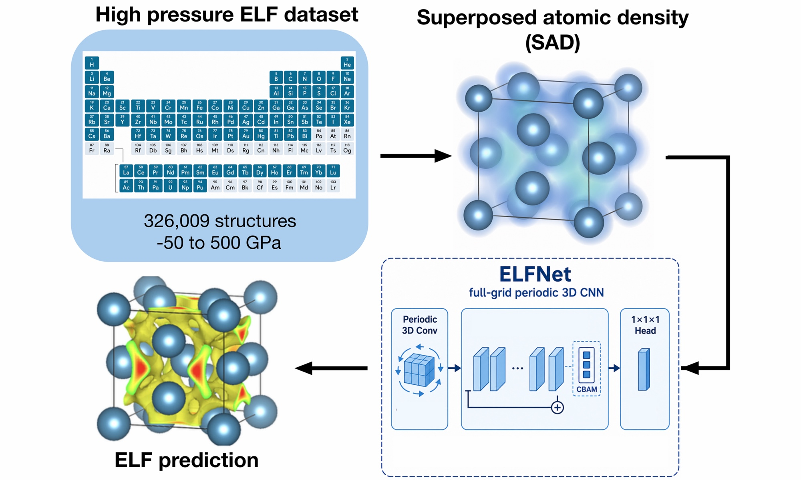
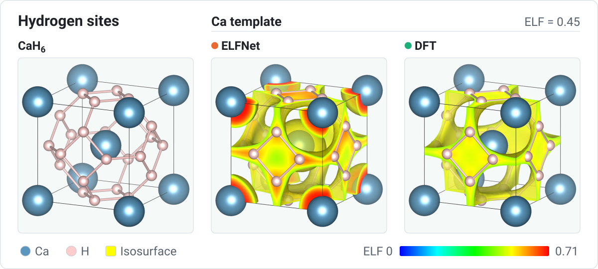
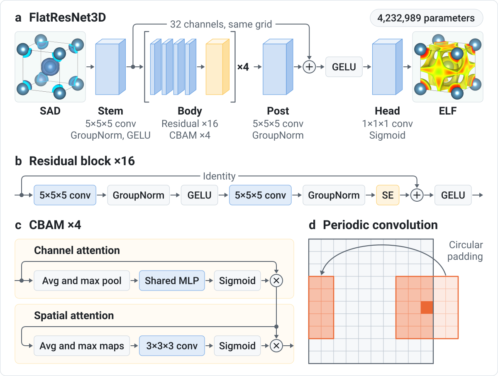

ELFNet predicts electron localization function (ELF) grids from superposed
atomic density (SAD) grids for periodic crystal structures. It is described in
[Ellis, Ellis, and Miao, *J. Mater. Inf.* 2026, 6, 45](https://doi.org/10.20517/jmi.2026.44).

The repository includes inference and training code, a POSCAR example, and
packaged neutral-density tables.

All ELFNet data is available on Zenodo: <https://zenodo.org/records/20481629>.

## Why ELF

<picture>
  <source media="(prefers-color-scheme: dark)" srcset="docs/figures/hydrogen-dark.svg">
  
</picture>

Hydrogen in a superhydride sits where the metal lattice already localizes electrons.
The left panel is CaH6 with its hydrogen cage. The other two take the hydrogen out of
the calculation, keep only the calcium lattice, and draw the hydrogen sites back on top.
The ELF of the bare lattice forms a network between the atoms, and the hydrogen sites
sit on it, in the DFT field and in the ELFNet prediction. That makes ELF a way to screen
a metal lattice before any hydrogen is placed in it.

## Install

```bash
git clone git@github.com:Austin243/ELFNet.git
cd ELFNet
python -m pip install -e .
```

For training or fine-tuning:

```bash
python -m pip install -e ".[train]"
```

## Quick Inference

Inputs are POSCAR files named `POSCAR_*`. By default, inference looks for
`weights/elfnet.ckpt`.

```bash
elfnet-predict \
  examples/poscars \
  runs/example_outputs
```

You can pass another checkpoint path explicitly or set `ELFNET_CHECKPOINT`.

## Model

<picture>
  <source media="(prefers-color-scheme: dark)" srcset="docs/figures/model-dark.svg">
  
</picture>

The network never changes the grid, so the prediction has the shape of the SAD
input. Circular padding carries every convolution across the cell boundary,
which is the only periodic treatment in the model, and no pressure value is
given to it because pressure enters through the lattice. See
[ARCHITECTURE.md](ARCHITECTURE.md).

## Training And Fine-Tuning Data

Training uses paired NumPy arrays:

```text
<stem>_sad.npy
<stem>_elf.npy
```

Each pair must have identical full-grid shape. Shape-bucketed training groups
samples by exact grid shape.

Fine-tuning example:

```bash
elfnet-train /path/to/paired_sad_elf_arrays \
  --epochs 60 \
  --batch 16 \
  --accum 2 \
  --batching shape \
  --val-frac 0.05 \
  --lr 1e-4 \
  --arch flat_resnet \
  --base 32 \
  --flat-blocks 16 \
  --flat-kernel 5 \
  --flat-attention-every 4 \
  --loss-mode kendall \
  --lambda-grad 1.0 \
  --lambda-cdf 1.0 \
  --cdf-max-voxels 20000 \
  --val-metric loss
```

## Repository Layout

```text
src/elfnet/model.py       ELFPredictor and model backbones
src/elfnet/inference.py   POSCAR-to-ELFCAR full-grid inference
src/elfnet/data.py        full-grid paired SAD/ELF loaders
src/elfnet/train.py       Lightning trainer for training/fine-tuning
configs/default.yaml      architecture/training defaults
examples/poscars/         small POSCAR inference example
docs/figures/             figures in this README
```

See `MODEL_CARD.md` for model behavior and limitations.
